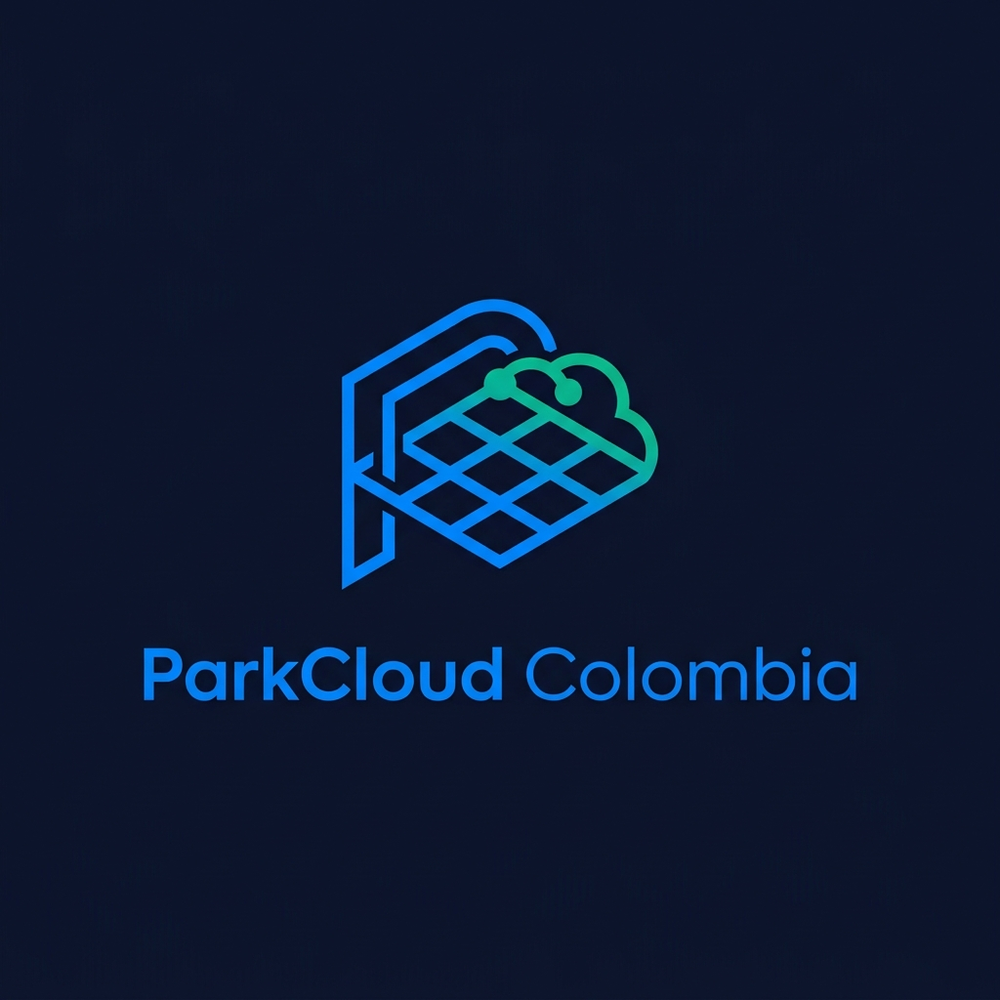
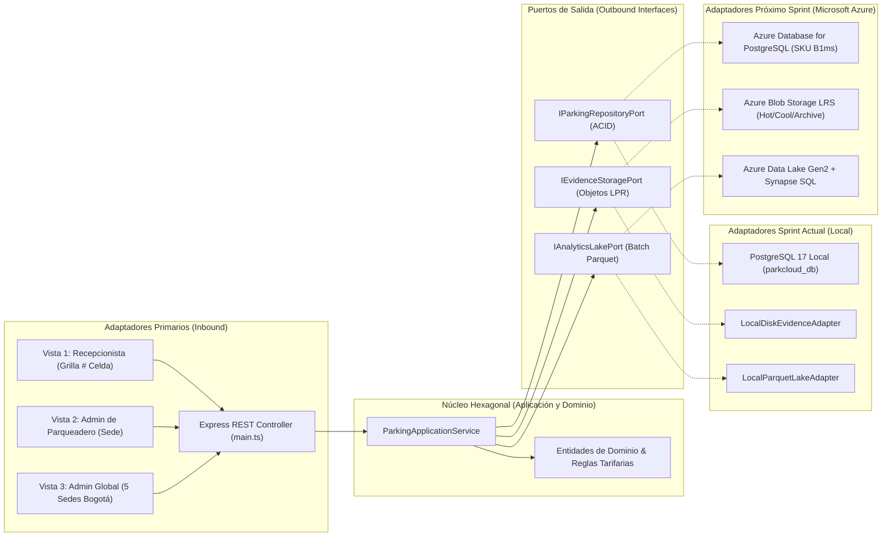
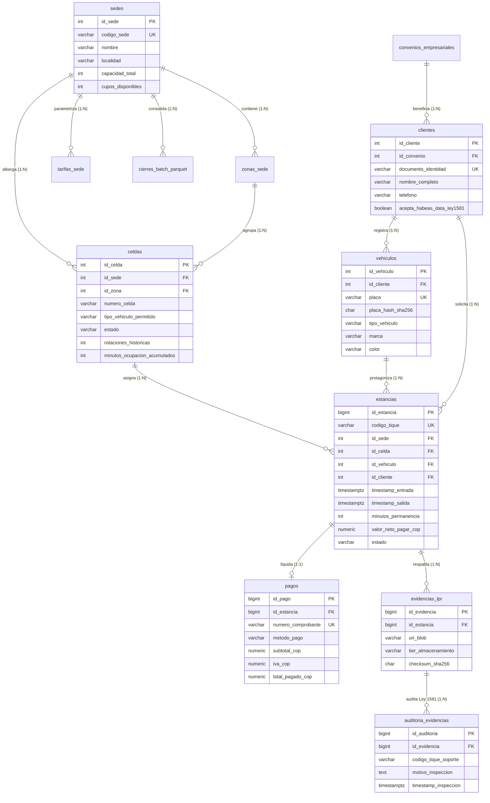

# ParkCloud Colombia - Plataforma Cloud Híbrida y Transaccional ACID para Gestión Multisede de Parqueaderos



**Universidad Distrital Francisco José de Caldas - Facultad de Ingeniería**  
**Asignatura:** Arquitectura y Almacenamiento de Datos en la Nube (2026-3)  
**Autores del Proyecto:**
- **Mauricio Sánchez Aguilar** - `20212020045`
- **Anderson Esteban Arévalo Rodríguez** - `20231020112`
- **Miguel Ángel Pedroza Vanegas** - `20212020013`

---

## 1. Descripción General del Proyecto

**ParkCloud Colombia** es una solución empresarial *full-stack* diseñada para centralizar, controlar y auditar en tiempo real la operación transaccional, el recaudo financiero, las evidencias fotográficas LPR (*License Plate Recognition*) y la analítica histórica de una red de **5 sedes de parqueaderos urbanos en Bogotá D.C.** (*Chapinero*, *Calle 100*, *Centro Internacional*, *Salitre Plaza* y *Usaquén*), con una capacidad instalada de **200 cupos físicos por sede (1.000 cupos en total)** y una grilla operativa interactiva de **40 bahías numeradas por sede (`#A-01` a `#D-40`)**.

El sistema resuelve los tres problemas críticos identificados en el anteproyecto:
1. **Inconsistencia de cupos y cobros por concurrencia:** Eliminada mediante un motor relacional **PostgreSQL en Tercera Forma Normal (3FN)** con transacciones estrictas **ACID**, bloqueo pesimista de filas (`SELECT ... FOR UPDATE`), restricciones `CHECK` e índices únicos parciales.
2. **Acoplamiento tecnológico al entorno local:** Resuelto mediante **Arquitectura Hexagonal (Ports & Adapters)**, permitiendo operar hoy sobre **PostgreSQL 17 Local + Almacenamiento en Disco** y migrar en **1 semana (próximo sprint)** hacia **Microsoft Azure** cambiando únicamente las variables de entorno sin modificar la lógica de negocio.
3. **Cumplimiento legal y costos de almacenamiento de imágenes:** Resuelto mediante anonimización criptográfica irreversible (`SHA-256 + Salt`) de placas vehiculares para la capa analítica, auditoría obligatoria con tique de soporte antes de visualizar fotografías (**Ley Estatutaria 1581 de 2012** y **Decreto 1377 de 2013**), y políticas de ciclo de vida por capas (*Hot -> Cool -> Archive -> Purga*).

---

## 2. Stack Tecnológico y Estructura del Repositorio

| Capa del Sistema | Tecnología / Estándar | Propósito en el Proyecto |
| :--- | :--- | :--- |
| **Frontend SPA** | **Angular 18** (Standalone Components, TypeScript, CSS Grid/Flexbox) | Vistas diferenciadas por rol, grilla interactiva de parqueaderos (`#A-01` a `#D-40`), mapas de calor espaciales/temporales y visor ER. |
| **Backend Core** | **Node.js + Express + TypeScript** | API RESTful bajo **Arquitectura Hexagonal**, inyección de puertos y conmutación en caliente entre proveedores Local y Azure. |
| **Motor OLTP (ACID)** | **PostgreSQL 17** (`pg` Pool nativo + PL/pgSQL) | Persistencia relacional 3FN, procedimientos almacenados ACID, control de concurrencia y vistas analíticas. |
| **Almacenamiento Objetos** | **Adaptador Local / Azure Blob Storage LRS** | Resguardo de evidencias fotográficas LPR (`evidencias/{año}/{mes}/{sede}/{id}.jpg`) con ciclo *Hot/Cool/Archive*. |
| **Data Lake Analítico** | **Adaptador Parquet Local / Azure Data Lake Gen2** | Consolidación nocturna *batch* en formato **Apache Parquet (compresión Snappy)** con placas anonimizadas (`SHA-256`). |

### Estructura de Carpetas

```text
ParkCloud Colombia/
├── logo-parkcloud.png                       # Logo minimalista oficial generado con Nano Banana
├── Consola_y_Diagrama_ER_ParkCloud.html     # Consola web autocontenida + Visor interactivo del Diagrama ER
├── README.md                                # Documentación integral del proyecto
├── database/                                # Scripts SQL del Modelo Relacional ACID + Data Warehouse Estrella (PostgreSQL 17)
│   ├── 01_schema_acid.sql                   # DDL 3FN: 13 tablas, restricciones CHECK, FKs e índices únicos parciales
│   ├── 02_procedures_acid.sql               # Funciones PL/pgSQL ACID (FOR UPDATE, SHA-256 Ley 1581, cobro mín $2.000, liquidación)
│   ├── 03_seed_bogota_5_sedes.sql           # Poblamiento inicial de las 5 sedes de Bogotá, 200 celdas y estancias
│   └── 04_datalake_dwh_iam_audit.sql        # Login IAM SHA-256, Cifrado AES-256, Data Lake (Raw/Trusted/Refined), DWH Estrella, ETL y CloudTrail
├── backend/                                 # Servidor Node.js + Express en Arquitectura Hexagonal
│   ├── package.json
│   ├── tsconfig.json
│   ├── .env                                 # Configuración de conexión PostgreSQL y modo Hexagonal (LOCAL / AZURE)
│   └── src/
│       ├── domain/
│       │   └── models.ts                    # Entidades puras del dominio e invariantes del negocio
│       ├── ports/
│       │   └── outbound/
│       │       └── HexagonalPorts.ts        # Interfaces IParkingRepositoryPort, IEvidenceStoragePort, IAnalyticsLakePort
│       ├── adapters/
│       │   └── outbound/
│       │       ├── CloudAndLocalAdapters.ts # Adaptadores intercambiables (Disco Local <-> Azure Blob / ADLS Gen2)
│       │       └── postgres/
│       │           └── PostgresParkingRepository.ts # Adaptador PostgreSQL con auto-creación y seed de parkcloud_db
│       ├── application/
│       │   └── ParkingService.ts            # Casos de uso, reglas de negocio y calculadora FinOps
│       └── main.ts                          # Punto de entrada HTTP Express (Puerto 4000)
└── frontend/                                # Aplicación SPA en Angular 18
    ├── package.json
    ├── angular.json
    ├── tsconfig.json
    └── src/
        ├── index.html                       # Carga de las 3 familias tipográficas oficiales
        ├── styles.css                       # Sistema de diseño, paleta cromática y estilos de mapas de calor
        ├── main.ts
        └── app/
            ├── app.component.ts             # Lógica de las 4 pestañas (Operador, Admin Sede, Admin Global, Modelo ER)
            ├── app.component.html           # Plantilla HTML de todas las vistas y formularios ACID
            └── services/
                └── parkcloud-api.service.ts # Cliente HTTP conectado al backend hexagonal
```

---

## 3. Identidad de Marca Definida (Brand Guidelines)

### 3.1. Logotipo Minimalista (Nano Banana)
El logotipo oficial (`logo-parkcloud.png`) representa un escudo isométrico de nube con una grilla interna de bahías de estacionamiento y el monograma **P** iluminado en cian telemetría sobre fondo azul medianoche.

### 3.2. Sistema de 3 Tipografías
1. **Títulos y KPIs Ejecutivos (`Space Grotesk` - 700 Bold):** Tipografía geométrica técnica utilizada en encabezados de módulos, métricas de capacidad y títulos de tableros.
2. **Subtítulos, Navegación y Botones (`Plus Jakarta Sans` - 500 Medium / 600 SemiBold):** Tipografía moderna de alta legibilidad para pestañas de navegación, etiquetas de formularios y subtítulos.
3. **Contenido, Tablas, Placas y Hashes (`Inter` Regular + `JetBrains Mono`):** `Inter` para texto corrido y `JetBrains Mono` para placas vehiculares (`KLM842`), códigos de celda (`#A-01`), valores monetarios en COP y hashes criptográficos `SHA-256`.

### 3.3. Paleta Cromática Oficial

| Nombre del Token | Código HEX | Uso Semántico en la Interfaz |
| :--- | :--- | :--- |
| **Deep Midnight Navy** | `#0B132B` | Fondo principal de la plataforma (modo oscuro ergonómico para operación 24/7). |
| **Slate Surface** | `#162447` | Superficie de tarjetas, contenedores de mapas de calor y paneles laterales. |
| **Azure Sovereign Blue** | `#0066FF` | Color primario de marca, pestañas activas y acciones de nube. |
| **Telemetry Cyan** | `#00D2FF` | Indicadores de telemetría IoT/LPR, selección activa en grilla y enlaces técnicos. |
| **ACID Emerald** | `#10B981` | Celda de parqueadero `DISPONIBLE` (libre), confirmación de transacción ACID y ahorros FinOps. |
| **Thermal Amber** | `#F59E0B` | Ocupación media-alta (60% - 80%) y alertas preventivas de capacidad. |
| **Occupied Crimson** | `#EF4444` | Celda de parqueadero `OCUPADA`, congestión crítica (>80%) y liquidación de salida. |

---

## 4. Arquitectura Hexagonal (Ports & Adapters)

El backend se diseñó bajo el patrón de **Arquitectura Hexagonal** para garantizar que el núcleo de dominio no dependa de ningún SDK específico de nube ni de almacenamiento físico:



---

## 5. Modelo de Datos Relacional 3FN y Principios ACID

### 5.1. Diagrama Entidad-Relación (ER)



### 5.2. Implementación de los 4 Principios ACID en PostgreSQL
- **Atomicidad (Atomicity):** Los procedimientos almacenados `fn_registrar_ingreso_acido` y `fn_liquidar_salida_acida` ejecutan todas las inserciones y actualizaciones dentro de un único bloque transaccional. Si falla cualquier validación (por ejemplo, celda ocupada o monto inválido), PostgreSQL ejecuta `ROLLBACK` total.
- **Consistencia (Consistency):**
  - `CHECK (cupos_disponibles >= 0 AND cupos_disponibles <= capacidad_total)` en la tabla `sedes`.
  - `CHECK (valor_neto_pagar_cop >= 0)` y validación de estados permitidos en `estancias` y `pagos`.
  - Índices únicos parciales:
    - `CREATE UNIQUE INDEX idx_unica_celda_activa ON estancias(id_celda) WHERE estado = 'ACTIVA';` (impide físicamente que dos vehículos ocupen el mismo `# del parqueadero` al mismo tiempo).
    - `CREATE UNIQUE INDEX idx_unico_vehiculo_activo ON estancias(id_vehiculo) WHERE estado = 'ACTIVA';` (impide que una misma placa tenga dos ingresos abiertos simultáneamente).
- **Aislamiento (Isolation):** Uso de bloqueo pesimista `SELECT ... INTO v_estado FROM celdas WHERE id_celda = p_id_celda FOR UPDATE;` al registrar una entrada o salida, serializando peticiones concurrentes sobre la misma celda.
- **Durabilidad (Durability):** Confirmación en disco mediante el *Write-Ahead Log (WAL)* de PostgreSQL 17 y registro inmutable de auditorías y pagos.

---

## 6. Autenticación IAM / RBAC con Contraseña Hasheada (`SHA-256 + Salt`) y Segregación de Vistas

El sistema cuenta con una pantalla de **Login IAM** respaldada por la tabla `usuarios_sistema` en PostgreSQL y la función criptográfica `fn_hash_password_iam(password || '::PARKCLOUD_IAM_SALT_2026')`. Al autenticarse, cada usuario accede **únicamente a la vista y sede que le corresponden por principio de mínimo privilegio**:

| Perfil / Rol IAM | Usuario / Correo Institucional | Contraseña | Vistas Desbloqueadas | Alcance de Sede |
| :--- | :--- | :--- | :--- | :--- |
| **1. Recepcionista de Sede (`OPERADOR_SEDE`)** | `lvgomez.chp@parkcloud.co` | `Park2026*` | **Únicamente Vista 1:** Recepcionista (Operación `# Celda`) | Fijado a **Sede 1 (Chapinero)** |
| **2. Admin de Parqueadero Local (`ADMIN_SEDE`)** | `admin.chapinero@parkcloud.co` | `Park2026*` | **Únicamente Vista 2:** Admin de Parqueadero (Sede) | Fijado a **Sede 1 (Chapinero)** |
| **3. Administrador Global (`ADMIN_GLOBAL`)** | `msancheza@udistrital.edu.co` | `Park2026*` | **Vista 3:** Admin Global (5 Sedes + Data Lake + DWH + ETL + CloudTrail) y **Vista 4:** Diagramas ER (3FN + Estrella) | **Multisede (Las 5 Sedes de Bogotá)** |

---

## 7. Reglas de Negocio Operativas y Vistas por Rol

### 7.1. Vista 1 - Recepcionista / Operador de Parqueadero (`OPERADOR_SEDE`)
Implementa el flujo operativo transaccional en tiempo real:
1. **Ingreso de un Cliente (Check-In) y Regla de 1 Parqueadero por Persona (`CC`):**
   - El recepcionista selecciona un **`# del parqueadero`** disponible (verde, ej. `#A-04`) en la grilla interactiva de 40 celdas.
   - El sistema valida mediante el índice único parcial `idx_unico_cliente_activo` y el procedimiento `fn_registrar_ingreso_acido` que **una misma persona (`documento_identidad` / Cédula) solo pueda alquilar un parqueadero activo a la vez en toda la red**. Si la cédula ya tiene un cupo activo, bloquea el registro e informa en qué sede y celda se encuentra estacionada.
2. **Pre-liquidación con Reloj en Vivo y Tarifa Mínima de `$2.000 COP` (hasta 15 min):**
   - Al seleccionar una celda ocupada (roja, ej. `#A-07`), se muestra un **cronómetro en vivo segundo a segundo**.
   - **Regla de Cobro Mínimo:** Del minuto `1` al minuto `15` se cobra una tarifa base fija de **`$2.000 COP`**. A partir del minuto `16`, se suma cada minuto adicional según la tarifa del tipo de vehículo (`$2.000 + (minutos - 15) * valor_minuto_cop`).
   - El recepcionista puede calcular el pago sin dar salida; si hace clic en **`Salir sin Agregar Pago`**, la celda sigue ocupada y el tiempo continúa corriendo en tiempo real.
3. **Recuadro Interactivo de `Agregar Pago` (Efectivo con Vueltas COP y Nequi/Transferencia con Foto):**
   - **Pago en Efectivo (`EFECTIVO`):** Permite digitar con cuánto paga el cliente (ej. `$100.000 COP`), calcula automáticamente las **vueltas exactas a devolver** y sugiere **3 combinaciones óptimas de billetes y monedas colombianas** (`$100k, $50k, $20k, $10k, $5k, $2k, $1.000, $500, $200, $100, $50`).
   - **Pago por Nequi / DaviPlata / Transferencia (`PSE_NEQUI_DAVIPLATA`):** Solicita el número de referencia de la transferencia y permite **tomar fotografía del comprobante con la cámara web**, subir imagen o generar comprobante digital para auditoría.

### 7.2. Vista 2 - Administrador de Parqueadero Local (`ADMIN_SEDE`)
- **Mapa de Calor Espacial por Celda (`#A-01` a `#D-40`):** Colorea cada bahía del parqueadero según su índice térmico de rotación histórica y minutos acumulados de ocupación.
- **Mapa de Calor Temporal de la Sede (7 Días x 18 Horas):** Matriz horaria de `05:00` a `22:00` de lunes a domingo para identificar horas Valle, Moderadas y Pico en la sede.
- **Editor de Tarifas en Vivo:** Permite actualizar el valor por minuto, tarifa plena diaria y mensualidad de cada tipo de vehículo.
- **Bóveda de Evidencias LPR y Auditoría Ley 1581:** Muestra el ciclo de vida de cada imagen (`HOT`, `COOL`, `ARCHIVE`) y exige registrar un código de tique de soporte y motivo legal antes de desbloquear la URI del objeto.

### 7.3. Vista 3 - Administrador de Todos los Parqueaderos (`ADMIN_GLOBAL`)
- **Tablero Ejecutivo Multisede:** Comparativa en tiempo real de ocupación, estancias activas y recaudo financiero de las **5 sedes de Bogotá**.
- **Arquitectura Data Lake Medallion (`Raw`, `Trusted`, `Refined`) y Pipeline ETL Serverless:** Visualiza los objetos almacenados en cada zona del Data Lake y permite disparar en vivo el procedimiento `fn_ejecutar_pipeline_etl_estrella`.
- **Cubo OLAP del Data Warehouse (`Esquema Estrella`):** Consulta analítica multidimensional en vivo cruzando la tabla de hechos `dw_fact_estancias_recaudo` con sus 5 dimensiones.
- **Gobierno de Seguridad (`AES-256 At-Rest` / `TLS 1.3 In-Transit`) y Monitor `CloudTrail / CloudWatch`:** Muestra muestras reales de cifrado simétrico `AES-256` sobre datos sensibles de clientes (`pgp_sym_encrypt`) y la bitácora de eventos IAM en tiempo real.

---

## 8. Data Lake Medallion (`Raw / Trusted / Refined`), Data Warehouse (`Esquema Estrella`) y Pipeline ETL

Para cumplir íntegramente con los lineamientos de la Guía de Proyecto Final, la plataforma implementa la separación entre el mundo transaccional (**OLTP 3FN**) y el ecosistema analítico (**Data Lake + Data Warehouse Dimensional**):

```mermaid
flowchart LR
    OLTP["Base OLTP 3FN (PostgreSQL ACID)\nestancias, pagos, vehiculos, clientes"]
    RAW["Zona 1: RAW (Bronce)\nJSON/CSV Crudo + LPR JPEG\ndatalake/raw/"]
    TRUSTED["Zona 2: TRUSTED (Plata)\nParquet Snappy Limpio + Placas SHA-256\ndatalake/trusted/"]
    REFINED["Zona 3: REFINED (Oro)\nParquet Agregado Financiero\ndatalake/refined/"]
    DWH["Data Warehouse (Esquema Estrella)\ndw_fact_estancias_recaudo + 5 Dimensiones"]

    OLTP -->|"Ingesta CDC / Batch"| RAW
    RAW -->|"Limpieza + Anonimización Ley 1581"| TRUSTED
    TRUSTED -->|"Reglas de Negocio + IVA 19%"| REFINED
    REFINED -->|"fn_ejecutar_pipeline_etl_estrella()"| DWH
```



### Esquema Estrella del Data Warehouse (`database/04_datalake_dwh_iam_audit.sql`)
- **Tabla de Hechos Central (`dw_fact_estancias_recaudo`):** Almacena las métricas cuantitativas aditivas (`minutos_permanencia`, `recaudo_bruto_cop`, `descuento_otorgado_cop`, `iva_recaudado_cop`, `recaudo_neto_cop`, `rotacion_celda_unidades`) y las llaves foráneas sustitutas (`sk_*`).
- **5 Tablas de Dimensiones Desnormalizadas:**
  1. `dw_dim_tiempo` (`sk_tiempo`, `fecha`, `anio`, `mes`, `dia_semana`, `hora_dia`, `franja_horaria`).
  2. `dw_dim_sede` (`sk_sede`, `codigo_sede`, `nombre_sede`, `localidad`, `capacidad_instalada`).
  3. `dw_dim_vehiculo_anonimizado` (`sk_vehiculo`, `placa_hash_sha256` sin PII por Ley 1581, `tipo_vehiculo`, `marca_homologada`).
  4. `dw_dim_tarifa_convenio` (`sk_tarifa`, `modalidad_tarifa`, `nombre_convenio`, `cobra_minimo_15min`).
  5. `dw_dim_metodo_pago` (`sk_metodo_pago`, `metodo_pago`, `canal_recaudo`, `requiere_conciliacion_bancaria`).

---

## 9. Referencia de Endpoints de la API REST (`http://localhost:4000`)

| Método | Ruta del Endpoint | Descripción Funcional |
| :--- | :--- | :--- |
| `POST` | `/api/auth/login` | Valida usuario/correo y contraseña contra el hash `SHA-256 + Salt` en PostgreSQL, registra evento en CloudTrail y retorna vistas autorizadas por rol IAM. |
| `GET` | `/api/datalake-dwh/estado` | Retorna los objetos de las zonas `RAW`, `TRUSTED` y `REFINED` del Data Lake, métricas y cubo OLAP del `Esquema Estrella`, estado de cifrado `AES-256` y eventos `CloudTrail`. |
| `POST` | `/api/datalake-dwh/ejecutar-etl` | Ejecuta el Pipeline ETL Serverless (`OLTP -> Raw -> Trusted -> Refined -> Esquema Estrella`) y escribe los artefactos en `storage_local/datalake/`. |
| `GET` | `/api/arquitectura` | Retorna el estado activo de los puertos y adaptadores hexagonales (`LOCAL` o `AZURE_CLOUD`). |
| `POST` | `/api/arquitectura/switch-provider` | Conmuta en caliente los adaptadores de almacenamiento entre entorno Local y Microsoft Azure. |
| `GET` | `/api/dashboard/global` | Retorna KPIs consolidados de las 5 sedes, mapa de calor 7x18 global, cierres Parquet y métricas FinOps. |
| `GET` | `/api/dashboard/sede/:idSede` | Retorna el estado de las 40 celdas de la sede, mapa de calor espacial/horario, tarifas, pagos y evidencias LPR. |
| `POST` | `/api/estancias/ingreso` | Ejecuta la transacción ACID de entrada vehicular, valida 1 cupo activo por cédula (`CC`), bloquea la celda (`FOR UPDATE`) y guarda la hora de ingreso. |
| `GET` | `/api/estancias/:idEstancia/preliquidacion` | Calcula en tiempo real los minutos transcurridos, cobro mínimo de `$2.000 COP` (hasta 15 min), descuentos e IVA (19%) sin cerrar la estancia. |
| `POST` | `/api/estancias/:idEstancia/salida` | Ejecuta la transacción ACID de salida, registra el pago inmutable y libera el `# del parqueadero`. |
| `PUT` | `/api/tarifas/:idTarifa` | Actualiza los valores tarifarios por tipo de vehículo en una sede específica. |
| `POST` | `/api/evidencias/:idEvidencia/auditar` | Registra un evento inmutable de auditoría bajo la Ley 1581 de 2012 para desbloquear una evidencia LPR. |
| `POST` | `/api/datalake/cierre-batch` | Genera un archivo consolidado `.snappy.parquet` con placas anonimizadas (`SHA-256`) para la sede indicada. |

---

## 8. Manual de Despliegue Paso a Paso (Local, Docker y Microsoft Azure)

Este manual detalla las tres modalidades oficiales para desplegar **ParkCloud Colombia**:
- **Modalidad A:** Despliegue nativo en estación de trabajo local (Windows / Linux / macOS).
- **Modalidad B:** Despliegue contenerizado reproducible mediante `Docker Compose`.
- **Modalidad C:** Despliegue en la nube sobre **Microsoft Azure** (Plan de Migración en 1 Semana).

---

### 8.1. Modalidad A - Despliegue Nativo en Entorno Local

#### 1. Requisitos Previos del Sistema
Verifica en una terminal (`PowerShell` o `Bash`) que las herramientas base estén instaladas y activas:

```powershell
# 1. Verificar versión de Node.js (v20 LTS o v24+) y npm
node --version
npm --version

# 2. Verificar que el servicio local de PostgreSQL esté en ejecución (Windows)
Get-Service -Name "postgresql*"
```

#### 2. Configuración de Variables de Entorno (`backend/.env`)
El archivo `backend/.env` controla tanto la conexión al motor transaccional PostgreSQL como los adaptadores de salida de la **Arquitectura Hexagonal**:

```ini
# Puerto del servidor HTTP Express
PORT=4000

# Credenciales del motor relacional PostgreSQL 17 Local
PGHOST=localhost
PGPORT=5432
PGUSER=postgres
PGPASSWORD=postgres
PGDATABASE=parkcloud_db

# Adaptadores Hexagonales Activos (Valores: LOCAL_DISK | AZURE_BLOB_LRS)
STORAGE_PROVIDER=LOCAL_DISK
# Adaptador de Data Lake Analítico (Valores: LOCAL_PARQUET | AZURE_DATALAKE_GEN2)
LAKE_PROVIDER=LOCAL_PARQUET

# Sal criptográfica institucional para anonimización SHA-256 (Ley 1581 de 2012)
LEY1581_SALT=SALT_PARKCLOUD_BOGOTA_LEY1581_2026
```

#### 3. Creación y Poblamiento de la Base de Datos ACID (`parkcloud_db`)
Tienes dos opciones para inicializar la base de datos:

- **Opción Automática (Recomendada):** Al iniciar el backend (`node dist/main.js`), la clase `PostgresParkingRepository` se conecta automáticamente a `localhost:5432`, crea la base de datos `parkcloud_db` si no existe y ejecuta en orden estricto los tres scripts SQL (`01_schema_acid.sql`, `02_procedures_acid.sql` y `03_seed_bogota_5_sedes.sql`).
- **Opción Manual por Consola (`psql`):** Si deseas ejecutar los scripts manualmente sobre tu instancia local de PostgreSQL:

```powershell
cd "c:\Users\USER\Desktop\Uni\2026-3\Arq y almacenamiento de datos en la nube\Proyecto final\ParkCloud Colombia"

# 1. Crear la base de datos (si aún no existe)
psql -U postgres -h localhost -c "CREATE DATABASE parkcloud_db;"

# 2. Ejecutar el esquema relacional 3FN con restricciones ACID e índices únicos parciales
psql -U postgres -h localhost -d parkcloud_db -f .\database\01_schema_acid.sql

# 3. Compilar los procedimientos almacenados ACID (SELECT ... FOR UPDATE y SHA-256)
psql -U postgres -h localhost -d parkcloud_db -f .\database\02_procedures_acid.sql

# 4. Cargar el Seed de las 5 sedes de Bogotá, 200 celdas y estancias históricas
psql -U postgres -h localhost -d parkcloud_db -f .\database\03_seed_bogota_5_sedes.sql
```

#### 4. Compilación y Puesta en Marcha del Backend Hexagonal (Puerto 4000)
```powershell
cd "c:\Users\USER\Desktop\Uni\2026-3\Arq y almacenamiento de datos en la nube\Proyecto final\ParkCloud Colombia\backend"

# Instalar dependencias de Node.js y TypeScript
npm install

# Compilar TypeScript a JavaScript de producción en ./dist
npm run build

# Iniciar el servidor Express + Adaptador PostgreSQL ACID
npm start
```
Al arrancar verás en consola:
```text
[PostgreSQL] Conectado exitosamente a localhost:5432/parkcloud_db (Motor Transaccional ACID Activo).
========================================================================
 PARKCLOUD COLOMBIA - BACKEND HEXAGONAL ACID ACTIVO EN PUERTO 4000
 CONSOLA WEB Y DIAGRAMA ER: http://localhost:4000
 API REST:                  http://localhost:4000/api/dashboard/global
========================================================================
```

#### 5. Compilación y Puesta en Marcha del Frontend Angular 18 (Puerto 4200)
- **Acceso rápido sin compilación adicional:** Abre directamente `http://localhost:4000` en el navegador para utilizar la consola web integrada y el visor del Diagrama ER servidos por Express.
- **Ejecución con servidor de desarrollo Angular CLI (`ng serve`):**
```powershell
cd "c:\Users\USER\Desktop\Uni\2026-3\Arq y almacenamiento de datos en la nube\Proyecto final\ParkCloud Colombia\frontend"

# Instalar paquetes de Angular 18
npm install

# Levantar servidor SPA en http://localhost:4200
npm start
```
- **Generación de artefactos estáticos de producción (`dist/`):**
```powershell
npm run build
```

#### 6. Pruebas de Humo Post-Despliegue (*Smoke Tests*)
Ejecuta estos comandos en `PowerShell` para verificar que el motor transaccional ACID responde correctamente:

```powershell
# Prueba 1: Verificar estado de la Arquitectura Hexagonal
Invoke-RestMethod -Uri "http://localhost:4000/api/arquitectura" -Method Get

# Prueba 2: Consultar el Dashboard Global de las 5 Sedes de Bogotá
Invoke-RestMethod -Uri "http://localhost:4000/api/dashboard/global" -Method Get | Select-Object kpis_globales

# Prueba 3: Consultar las 40 celdas y el mapa de calor de la Sede 1 (Chapinero)
Invoke-RestMethod -Uri "http://localhost:4000/api/dashboard/sede/1" -Method Get | Select-Object sede
```

---

### 8.2. Modalidad B - Despliegue Contenerizado con Docker Compose

El repositorio incluye los archivos [backend/Dockerfile](./backend/Dockerfile) y [docker-compose.yml](./docker-compose.yml) para levantar toda la infraestructura (`PostgreSQL 17 Alpine` + `Backend Hexagonal Node 20 Alpine` + `Consola Web`) en cualquier servidor Linux o Windows con un único comando:

```powershell
cd "c:\Users\USER\Desktop\Uni\2026-3\Arq y almacenamiento de datos en la nube\Proyecto final\ParkCloud Colombia"

# Construir imágenes e iniciar contenedores en segundo plano
docker compose up -d --build

# Verificar que ambos contenedores estén saludables (healthy / running)
docker compose ps

# Inspeccionar logs de inicialización ACID
docker compose logs -f backend-hexagonal
```
Para detener los contenedores conservando el volumen persistente de datos `pgdata_parkcloud`:
```powershell
docker compose down
```

---

### 8.3. Modalidad C - Manual de Despliegue Cloud en Microsoft Azure (Migración en 1 Semana)

Gracias a la **Arquitectura Hexagonal**, el paso a producción en la nube se realiza aprovisionando los servicios PaaS en **Microsoft Azure** (usando la suscripción *Azure for Students* con crédito de `$100 USD`) y conmutando las variables de entorno sin reescribir código de negocio.

#### Paso 1: Inicio de Sesión y Creación del Grupo de Recursos (`Azure CLI`)
```bash
# Iniciar sesión en Microsoft Entra ID
az login

# Definir variables de despliegue (Región recomendada por costo/latencia: eastus)
RESOURCE_GROUP="rg-parkcloud-colombia-prod"
LOCATION="eastus"
PG_SERVER_NAME="pg-parkcloud-bogota-acid"
STORAGE_ACCOUNT="stparkcloudbogotalpr"

# Crear el Grupo de Recursos
az group create --name $RESOURCE_GROUP --location $LOCATION
```

#### Paso 2: Aprovisionar Azure Database for PostgreSQL - Flexible Server (`SKU B1ms`)
```bash
# Crear instancia PostgreSQL 17 en tier Burstable Standard_B1ms (1 vCore, 2 GiB RAM, 32 GiB SSD)
az postgres flexible-server create \
  --resource-group $RESOURCE_GROUP \
  --name $PG_SERVER_NAME \
  --location $LOCATION \
  --admin-user parkcloud_admin \
  --admin-password "TuPasswordSeguraACID_2026!" \
  --sku-name Standard_B1ms \
  --tier Burstable \
  --storage-size 32 \
  --version 17 \
  --yes

# Crear la base de datos transaccional parkcloud_db
az postgres flexible-server db create \
  --resource-group $RESOURCE_GROUP \
  --server-name $PG_SERVER_NAME \
  --database-name parkcloud_db

# Ejecutar los 3 scripts SQL (Esquema 3FN, Procedimientos ACID y Seed de las 5 Sedes)
PGPASSWORD="TuPasswordSeguraACID_2026!" psql \
  "host=${PG_SERVER_NAME}.postgres.database.azure.com port=5432 dbname=parkcloud_db user=parkcloud_admin sslmode=require" \
  -f ./database/01_schema_acid.sql \
  -f ./database/02_procedures_acid.sql \
  -f ./database/03_seed_bogota_5_sedes.sql
```

#### Paso 3: Aprovisionar Azure Blob Storage LRS y Data Lake Storage Gen2 (`enable-hierarchical-namespace`)
```bash
# Crear Storage Account GPv2 con redundancia LRS y espacio jerárquico ADLS Gen2 activo
az storage account create \
  --name $STORAGE_ACCOUNT \
  --resource-group $RESOURCE_GROUP \
  --location $LOCATION \
  --sku Standard_LRS \
  --kind StorageV2 \
  --enable-hierarchical-namespace true \
  --allow-blob-public-access false \
  --min-tls-version TLS1_2

# Crear contenedor privado para evidencias fotográficas LPR (Ley 1581)
az storage container create \
  --account-name $STORAGE_ACCOUNT \
  --name evidencias-lpr \
  --auth-mode login

# Crear contenedor analítico para cierres nocturnos en formato Apache Parquet (Snappy)
az storage container create \
  --account-name $STORAGE_ACCOUNT \
  --name analitica-parquet \
  --auth-mode login
```

#### Paso 4: Configurar la Regla de Ciclo de Vida Automático (*Lifecycle Management*: Hot -> Cool -> Archive -> Purga)
Guarda el siguiente archivo como `lifecycle-lpr.json` y aplícalo a la cuenta de almacenamiento para reducir en un **60% el costo mensual por GB**:

```json
{
  "rules": [
    {
      "enabled": true,
      "name": "CicloVidaEvidenciasLey1581",
      "type": "Lifecycle",
      "definition": {
        "actions": {
          "baseBlob": {
            "tierToCool": { "daysAfterModificationGreaterThan": 30 },
            "tierToArchive": { "daysAfterModificationGreaterThan": 90 },
            "delete": { "daysAfterModificationGreaterThan": 365 }
          }
        },
        "filters": {
          "blobTypes": ["blockBlob"],
          "prefixMatch": ["evidencias-lpr/"]
        }
      }
    }
  ]
}
```
```bash
az storage account management-policy create \
  --account-name $STORAGE_ACCOUNT \
  --resource-group $RESOURCE_GROUP \
  --policy @lifecycle-lpr.json
```

#### Paso 5: Desplegar el Backend Hexagonal en Azure Container Apps y Conmutar Adaptadores
Actualiza las variables de entorno del contenedor en Azure para que los puertos hexagonales inyecten automáticamente los adaptadores de nube (`AzureBlobEvidenceAdapter` y `AzureDataLakeGen2Adapter`):

```bash
az containerapp up \
  --name ca-parkcloud-backend \
  --resource-group $RESOURCE_GROUP \
  --location $LOCATION \
  --source ./backend \
  --ingress external \
  --target-port 4000 \
  --env-vars \
    PGHOST="${PG_SERVER_NAME}.postgres.database.azure.com" \
    PGPORT="5432" \
    PGUSER="parkcloud_admin" \
    PGPASSWORD="TuPasswordSeguraACID_2026!" \
    PGDATABASE="parkcloud_db" \
    STORAGE_PROVIDER="AZURE_BLOB_LRS" \
    LAKE_PROVIDER="AZURE_DATALAKE_GEN2" \
    AZURE_STORAGE_ACCOUNT="$STORAGE_ACCOUNT"
```

#### Paso 6: Automatización FinOps (Apagado Programado Nocturno 23:30 a 05:30 COT)
Para reducir la factura mensual de **`$21.32 USD/mes`** a **`$8.50 USD/mes`** en ambientes académicos/demostrativos fuera del horario operativo de los parqueaderos:
```bash
# Detener el servidor PostgreSQL Flexible Server en horas inhábiles (libera cómputo vCore)
az postgres flexible-server stop --resource-group $RESOURCE_GROUP --name $PG_SERVER_NAME

# Iniciar nuevamente al comienzo de la jornada (05:30 AM)
az postgres flexible-server start --resource-group $RESOURCE_GROUP --name $PG_SERVER_NAME
```

---

### 8.4. Solución de Problemas Frecuentes (*Troubleshooting*)

| Síntoma / Error Detectado | Causa Raíz Probable | Solución Paso a Paso |
| :--- | :--- | :--- |
| `Error: password authentication failed for user "postgres"` | La instancia local `postgresql-x64-17` tiene una contraseña distinta a las predeterminadas. | Abre `backend/.env`, coloca tu contraseña en `PGPASSWORD=tu_clave` y reinicia `npm start`. (El backend activará mientras tanto la réplica transaccional ACID en memoria para no detener la interfaz). |
| `Error: Port 4000 is already in use (EADDRINUSE)` | Ya existe una instancia previa del backend corriendo en el puerto `4000`. | En PowerShell ejecuta `Stop-Process -Id (Get-NetTCPConnection -LocalPort 4000).OwningProcess -Force` o cambia `PORT=4001` en `backend/.env`. |
| `Transacción rechazada (ACID): La celda seleccionada ya se encuentra OCUPADA` | Dos operadores intentaron ocupar el mismo `# del parqueadero` simultáneamente. | Comportamiento esperado del bloqueo pesimista `SELECT ... FOR UPDATE`. Refresca la grilla y selecciona una celda en estado `DISPONIBLE` (verde). |
| `Por Ley 1581 de 2012 es obligatorio registrar el código de tique de soporte` | Se intentó abrir una fotografía LPR en la vista de Administrador sin justificación de auditoría. | Ingresa el número de tique (ej. `INC-2026-0915`) y el motivo legal en el modal de la tabla `auditoria_evidencias`. |

---

## 9. Presupuesto FinOps Validado (Crédito Azure for Students de $100 USD)

| Servicio en Microsoft Azure | SKU / Configuración | Costo 24/7 (USD/mes) | Costo con Apagado Programado (USD/mes) |
| :--- | :--- | :---: | :---: |
| **Azure Database for PostgreSQL** | Flexible Server Burstable `B1ms` (1 vCore, 2 GiB RAM) | `$12.41` | `$3.60` |
| **Almacenamiento SSD PostgreSQL** | 32 GiB Premium SSD P4 + Backups 7 días | `$3.68` | `$3.68` |
| **Azure Blob Storage LRS (LPR)** | 150 GB distribuidos en *Hot / Cool / Archive* | `$2.18` | `$0.95` |
| **Azure Data Lake Gen2 + Synapse** | 10 GB Parquet Snappy + Consultas Serverless SQL | `$0.45` | `$0.27` |
| **Azure Container Apps / App Service** | 0.5 vCPU, 1 GiB RAM (*Scale-to-zero* en horas inhábiles) | `$2.60` | `$0.00` |
| **Microsoft Entra ID + Azure Monitor** | RBAC Free Tier + Alertas presupuestarias (50%, 80%, 95%) | `$0.00` | `$0.00` |
| **TOTAL MENSUAL ESTIMADO** | **Sostenible 11.7 meses con el crédito de $100 USD** | **`$21.32 USD`** | **`$8.50 USD`** |
